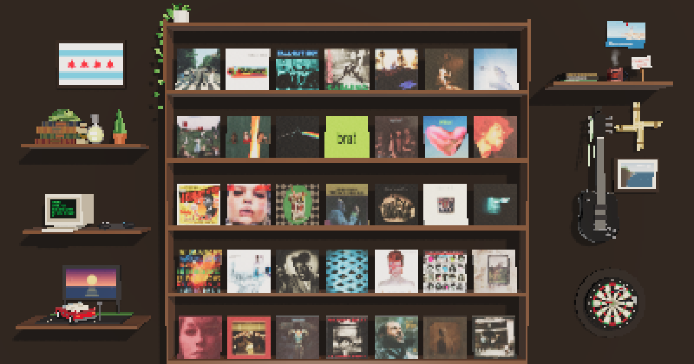

# Ann's Shelf

A pixel-art 3D record shelf in the browser. 37 albums I love, plus a wall of
knick-knacks from my life. Hover a record to pull it out and hear a preview;
hover anything on the side shelves and it reacts.

**[Open the live site →](https://alozich.github.io/anns-shelf/)**



Built with Three.js, Web Audio and Vite, in plain JavaScript with no UI framework.
Works on desktop and phones, and deploys automatically to GitHub Pages.

## What's interesting here

**Rendering**
- **Two-layer pixel-art look.** Every texture (album covers, wood, record grooves) is
  downsampled to a small pixel grid and sampled with hard-edged filtering, *and* the
  whole scene renders into a low-resolution half-float target that's upscaled with
  nearest-neighbour filtering. Tone mapping runs in the final upscale, so colours
  match an unpixelated render. Rendering at a fraction of the resolution also makes
  each frame cheaper. ([`src/pixel.js`](src/pixel.js), [`src/main.js`](src/main.js))
- **Physically based materials.** `MeshPhysicalMaterial` clearcoat gives the sleeves a
  glossy laminate over a grainy paper normal map; the vinyl uses an anisotropy map so
  the highlight runs around the grooves. ([`src/materials.js`](src/materials.js))
- **Procedural everything.** No 3D model files: the shelf, guitar, drive-in diorama,
  dartboard and the rest are built from primitives in code, and their artwork (flags,
  postcards, the looping "movie" on the drive-in screen) is drawn on canvases at runtime.
  ([`src/knickknacks.js`](src/knickknacks.js))

**Interaction**
- **Cheap, stable hover detection.** One raycast per frame at most, and only when the
  pointer or camera moves, against a flat list of low-poly invisible hit boxes rather
  than the scene graph. The hit boxes don't move, so a sleeve sliding out from under the
  cursor can't flicker between hovered and not. ([`src/hover.js`](src/hover.js))
- **Touch support.** Fingers can't hover, so on touch screens a tap selects and stays
  selected. Portrait screens fit the record shelf to the width and scroll sideways to
  the side shelves, with finer pixels on small screens.
- **Native scrolling over a fixed canvas.** A spacer element gives the page real
  scrollbars, and the scroll position drives the camera, so the wheel, scrollbar and
  touch scrolling all just work.

**Audio**
- **Synthesized sound effects.** Every knick-knack sound is generated with the Web
  Audio API: a Karplus-Strong guitar strum, a passing "L" train, a tin-whistle jig, a
  coffee pour, a dart's whoosh and thunk, and more. No audio files.
  ([`src/audio.js`](src/audio.js))
- **Song previews on every device.** 30-second Apple Music previews stream through a
  Web Audio gain node (not the `<audio>` element's volume, which iPhones ignore), so
  volume and fades behave the same everywhere. The browsers' autoplay rules are handled
  with a "click anywhere for sound" nudge.

**Performance**
- Runs at 60 FPS on an integrated Intel UHD 630 laptop GPU.
- Shadows re-render only while something is moving; the shelf frame is merged into
  one draw call; frames that run slow step the resolution down.

**Tooling**
- GitHub Actions builds and publishes the site on every push to `main`
  ([`.github/workflows/deploy.yml`](.github/workflows/deploy.yml)).
- A Draco + glTF loading pipeline is ready for compressed 3D models
  ([`src/loaders.js`](src/loaders.js)); the current scene is fully procedural.
- `npm run preview-image` regenerates the link-preview image by driving headless Chrome
  over the DevTools protocol ([`scripts/capture-preview.mjs`](scripts/capture-preview.mjs)).

## Run it locally

```sh
npm install
npm run dev
```

## Project layout

| Path | What's there |
|---|---|
| `src/main.js` | Renderer, pixelation pass, camera and scrolling, the render loop |
| `src/shelf.js` | The record shelf, sleeves and their hit boxes |
| `src/albums.js` | The record collection: titles, covers, preview tracks |
| `src/knickknacks.js` | Everything on the side shelves |
| `src/materials.js` | Sleeve, vinyl and wood materials and their procedural textures |
| `src/hover.js` | Hover and tap detection |
| `src/audio.js` | Song previews and the synthesized sound effects |
| `src/pixel.js` | Pixel-art settings |
| `src/loaders.js` | Draco/glTF model loading |
| `public/covers/` | Album cover images |

## Credits

Album artwork and song previews belong to their respective artists and labels,
via Apple Music. Font: [Pixelify Sans](https://fonts.google.com/specimen/Pixelify+Sans)
(SIL Open Font License). Built on [Three.js](https://threejs.org/).
